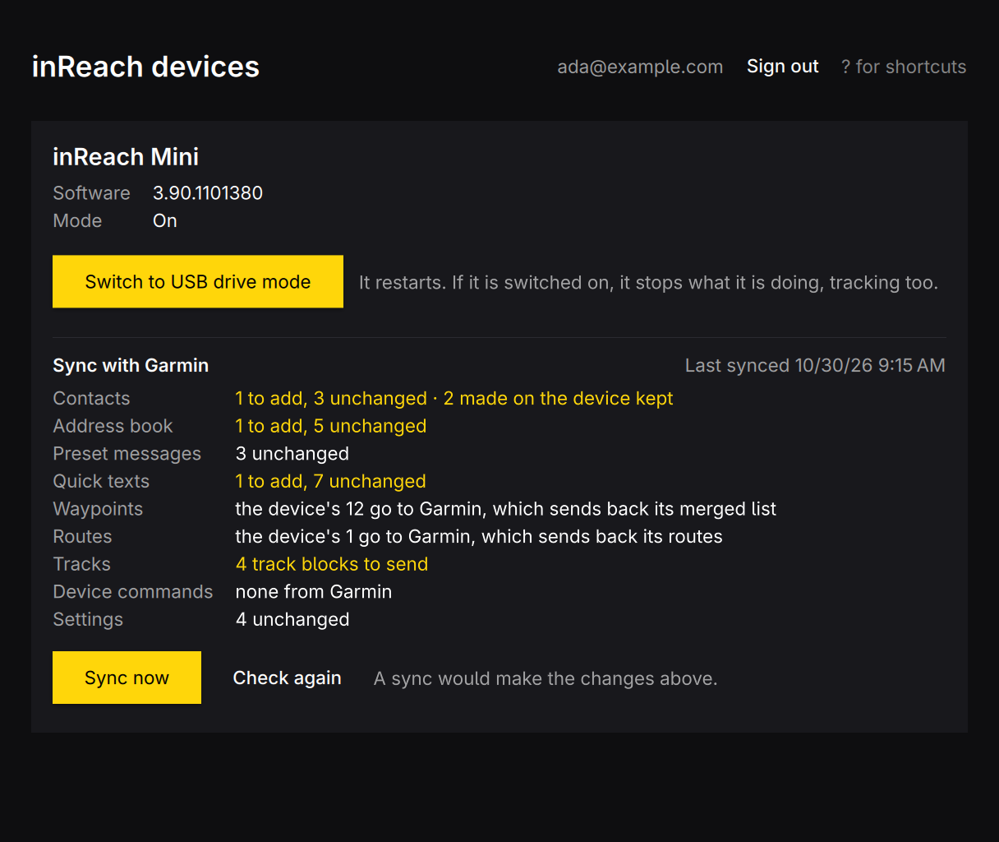

# nimrag-sync



Keeps a Garmin/DeLorme inReach in sync on Linux: its software, contacts,
preset messages and settings, as Garmin's inReach Sync does on Windows and
macOS. An app for [Omarchy](https://omarchy.org).

It does what inReach Sync 1.4.47 does, step for step: after you sign in to the
Garmin account the inReach is on (the one of explore.garmin.com), it shows what a
sync would change, then writes the contacts, address book, preset messages,
quick texts and settings from Garmin to the device and tells Garmin it did. It
keeps a copy of the device's tables first, and reads the device back after.
Waypoints, routes and tracks are not synced yet, and software updates go the
USB drive way (see below).

The window: plug the inReach in, sign in, switch it on if it is charging, and
**Sync now**. The password is kept in the desktop's keyring (Secret Service,
through `secret-tool`); the email address in `~/.config/nimrag-sync/account`.

## Languages

The window follows the language picked under Omarchy's Setup > Language, live: English and Swedish so
far. A language is a catalog in `src/i18n/<code>.json` (English text to translation), listed in
`src/resources.qrc`; `bin/test` fails when a catalog misses a text the window shows. Messages from the
core (errors, the command line) are in English.

## Devices

| Device | USB ID | Status |
|---|---|---|
| inReach Mini (1st generation) | `091e:0b89` | found, version and mode, USB drive mode — tried on a real device |
| inReach SE, Explorer, SE+, Explorer+ | `1163:0300` | found; untested |

The inReach Mini 2, Messenger and other Garmin-made devices are not inReach
Sync devices: they use Garmin Express.

## Access to the device

nimrag-sync talks to the inReach's USB HID interface (`/dev/hidraw*`), which
only root may open by default. The package installs a udev rule that lets the
user at the computer open it; when building from source, install it yourself:

```sh
sudo install -m644 pkgbuild/70-nimrag-sync.rules /etc/udev/rules.d/
sudo udevadm control --reload && sudo udevadm trigger --subsystem-match=hidraw
```

## Shortcuts

| Key | Action |
|---|---|
| Space, R | Ask the devices again |
| C | Check with Garmin what a sync would change |
| ? | Show or hide the shortcuts |
| Q | Quit |

## Command line

Everything the window does also works without a display, for scripts and
agents. Each command takes `--json`, exits 0 or 1, and writes errors to stderr.

| Command | What it does |
|---|---|
| `nimrag-sync` or `nimrag-sync open` | open the window |
| `nimrag-sync devices [--json]` | the connected inReach devices, their mode and software |
| `nimrag-sync drive-mode [--apply] [--json]` | restart an inReach as a USB drive; a trial run without `--apply` |
| `nimrag-sync app-mode [--apply] [--json]` | restart an inReach in its normal mode (it switches on); a trial run without `--apply` |
| `nimrag-sync tables [--json]` | the tables the inReach has and their versions (read only; needs app mode) |
| `nimrag-sync read-table <id> [--json]` | the rows of one table as the inReach sends them (read only; needs app mode) |
| `nimrag-sync login <email>`, `logout` | sign in (the password, typed or piped to stdin, goes to the keyring) and out |
| `nimrag-sync preview [--json]` | what a sync would change on the inReach (reads only; the inReach must be on) |
| `nimrag-sync sync [--apply] [--json]` | sync as inReach Sync does; a trial run, the preview, without `--apply` |
| `nimrag-sync server [<imei>] [--json]` | what Garmin's inReach service holds for the device: sync server, last sync, contacts, presets and quick texts (read only) |

## Building

A Rust core (`core/`, built with cargo as a static library) under a Qt Quick
window (`src/`, built with qmake6), linked into one binary.

```sh
bin/build      # cargo + qmake6 + make into build/nimrag-sync
bin/test       # the Rust tests and the Qt tests (offscreen)
bin/install    # makepkg -fsi: the app lands in the launcher
bin/screenshot [language] [out.png] [state.json]
               # the window with made-up state, captured on screen
```

`bin/screenshot` runs the real window with `tools/demo/`'s `FakeBackend` instead of the Rust core,
the state in `tools/demo/state.json`, the default accent and the language given (`en` when none),
floats it beside the pointer for a few seconds and saves it with `grim` (to `docs/screenshot.png`
by default). It needs Hyprland: Qt's offscreen platform does not draw Material's button
backgrounds. `bin/test` checks that `FakeBackend` keeps up with `Backend`.

## Protocol notes

`docs/device-protocol.md` and `docs/server-protocol.md` describe what inReach
Sync 1.4.47 does over USB and with Garmin's servers, read from its code.
`docs/device-observations.md` and `docs/server-observations.md` record what a
real inReach Mini and Garmin's servers answered.
`docs/account-api-swagger.json` is the published description of Garmin's
inReach account API.
